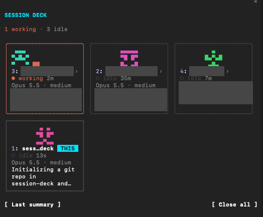

# Session Deck

A Claude Code pane listing every running Claude Code session on this machine: working, waiting on you, or idle.



- **A card per session** with its status, model, and a one-line summary of what it's doing. Keys `1`–`9` jump to a session's terminal tab.
- **Approval tray.** When a session needs permission and its tab isn't in front, the request waits in the deck: `y` allows, `n` denies with an optional reason the session reads, `j` jumps to its tab. Risky commands (`rm -rf`, `git push`, `sudo`, `curl … | sh`, writes outside the project) take a second press. Requests in auto mode are left to auto mode.
- **Close all / Resume.** Closes every session after writing an end-of-day summary to `~/session-deck-logs/`, and reopens them later.

Tab switching and the approval tray need macOS Terminal or iTerm2.

## Install

At the prompt of a terminal session:

```
/plugin install session-deck --marketplace JordanNgHSA/session-deck
```

Answer `y` to add the marketplace, then pick a scope.

From a shell:

```
claude plugin install session-deck --marketplace JordanNgHSA/session-deck
```

In the desktop app, where `/plugin` does not run: click + next to the prompt box, then Plugins, Add marketplace with `JordanNgHSA/session-deck`, then Add plugin.

## Use

The pane opens on its own when a session starts; `/sessions` opens it again, and `/sessions-motion` turns the faces' animation off or on.
